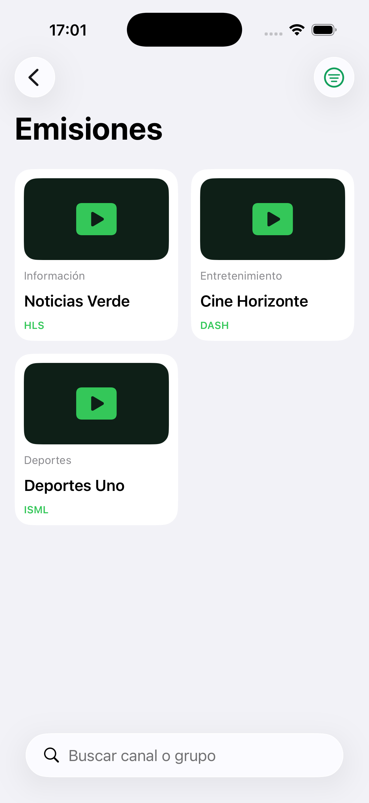
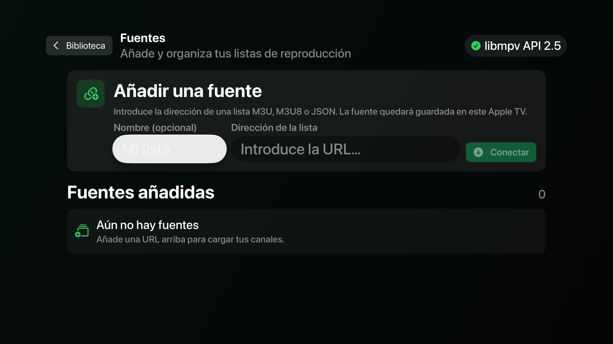

# InputStream Player

Repositorio público de InputStream Player. Aquí se publican la información de
la aplicación, ejemplos de listas compatibles y las releases verificables.

En los cajones de aplicaciones aparece como **ISPlayer**; dentro de la app,
con su nombre completo.

> InputStream Player está pensado para reproducir contenidos para los que el
> usuario tiene autorización de acceso. No incluye listas, credenciales ni
> claves de terceros.

[English version](README_en.md)

## Descargas

- **Última versión:** [releases/latest](https://github.com/jopsis/InputStreamPlayer/releases/latest)
- **Todas las versiones:** [Releases](https://github.com/jopsis/InputStreamPlayer/releases)
- **iPhone y iPad:** mejor desde el [source de SideStore](#añadir-inputstream-player-como-source-de-sidestore),
  que avisa de cada versión nueva.
- **Android:** después de la primera instalación, la app se actualiza sola
  (Ajustes → Buscar actualizaciones).

Cada archivo va con su checksum SHA-256. Antes de instalar, lee
[cómo verificar e instalar una release](docs/releases.md).

## Capturas

### iOS

### tvOS

## Qué hace

- **Directo** con guía de programación (XMLTV, con o sin gzip), cambio de
  canal con el mando y **catchup** para ver lo ya emitido cuando la lista
  declara el archivo del canal ([cómo declararlo](docs/formatos-de-listas.md#catchup)).
- **Bajo demanda:** las películas y series de las listas, con las series
  agrupadas por temporada, «Continuar» por donde lo dejaste y marca de visto.
  Los catálogos JSON pueden traer ficha completa (sinopsis, reparto, año,
  géneros, duración) y tráiler ([formato](docs/formatos-de-listas.md#catálogos-de-películas-y-series-json)).
- **Addons de Stremio:** catálogos, fichas con tráiler (desde TMDb) y enlaces de
  los addons que añadas, y listas de Trakt. Trae de serie Cinemeta (catálogos y
  fichas) y **OpenSubtitles** (subtítulos en tu idioma aunque el vídeo no los
  traiga); se admiten también otros addons de subtítulos.
- **Favoritos y recientes:** dos grupos fijos al principio de Emisiones. Un
  canal se añade a favoritos manteniéndolo pulsado o con la estrella del
  reproductor.
- **Multiview:** hasta cuatro canales en directo a la vez en una cuadrícula,
  desde el botón de cuadrícula del reproductor. Suena el cuadro elegido y
  cualquiera pasa a pantalla completa.
- **Pistas:** calidad de vídeo, idioma de audio y subtítulos elegibles. El
  idioma preferido se elige en Ajustes y la pista elegida a mano se recuerda en
  cada canal.
- **Sincronización opcional** de fuentes, ajustes y lo visto entre tus aparatos
  con tu propio Google Drive, y con **Trakt**.
- **DNS cifrado opcional** (XDP DNS), para redes cuyo DNS bloquea algunos
  servidores.
- **Android:** dos motores de reproducción, **ExoPlayer** (el predeterminado:
  los decodificadores y la conexión segura del sistema) y MPV (abre casi
  cualquier formato), a elegir en Preferencias o desde el propio reproductor; si un vídeo no abre con
  uno, la app ofrece probar con el otro. Actualizaciones desde la propia app y
  «Enviar registro», que
  manda al desarrollador un registro de fallos sin claves ni tokens
  ([privacidad](privacidad.md)).

## Compatibilidad

- Versiones para **iOS** (iPhone y iPad), **tvOS**, **macOS** (app nativa para Mac
  con Apple Silicon; ver más abajo) y
  **Android** (móvil, Google TV y Android TV, de 32 y 64 bits).
- **HLS** (`.m3u8`), incluido **SAMPLE-AES** cuando la fuente proporciona una
  clave ClearKey/raw-key autorizada.
- **DASH / MPD** (`.mpd`) con CENC y ClearKey/raw-key autorizada, también con
  una clave distinta por pista.
- **Microsoft Smooth Streaming** (`.ism` / `.isml` y `Manifest`) con
  ClearKey/raw-key autorizada.
- Ficheros de vídeo directos (MP4, MKV, TS…).
- Fuentes en formato **M3U/M3U8** y **JSON** (también los catálogos de
  películas y series de OTT Navigator), por URL o desde un fichero, y listas
  cifradas `.ispl`.

No se admiten licencias FairPlay, Widevine o PlayReady que requieran un servidor
de licencias. Una clave solo debe añadirse a una lista cuando el titular del
contenido haya autorizado expresamente su uso.

## Ejemplos de listas

- [M3U/M3U8](samples/inputstreamplayer.m3u): HLS, DASH/MPD y Smooth Streaming,
  con y sin ClearKey.
- [JSON](samples/inputstreamplayer.json): formato plano de canales.
- [Catálogo JSON](samples/catalogo-vod.json): una película y una serie bajo
  demanda, con ficha y tráiler.
- [Referencia completa de formatos](docs/formatos-de-listas.md).

Los ficheros combinan ejemplos estructurales con demostraciones públicas de
terceros. La disponibilidad de estas últimas depende de sus proveedores; las
claves de los ejemplos estructurales son valores de reserva.

## Instalación en iPhone y iPad

InputStream Player se instala mediante **SideStore**, preferiblemente dentro de
**LiveContainer**. Sigue primero las guías oficiales de instalación:

- [Instalar SideStore](https://docs.sidestore.io/docs/installation/install)
- [Instalar LiveContainer con SideStore](https://livecontainer.github.io/docs/installation)

La distribución mediante SideStore requiere una cuenta de Apple válida y está
sujeta a los límites de firma de Apple.

### Añadir InputStream Player como source de SideStore

En vez de descargar el IPA a mano en cada release, añade este repositorio como
**source** de SideStore y las nuevas versiones aparecerán ahí con un botón
"Update":

- Botón directo (ábrelo desde el iPhone/iPad, no funciona en escritorio):
  [`sidestore://source?url=https://jopsis.github.io/InputStreamPlayer/sidestore/apps.json`](sidestore://source?url=https%3A%2F%2Fjopsis.github.io%2FInputStreamPlayer%2Fsidestore%2Fapps.json)
- Añadir a mano en SideStore → Sources → **+** → Add Source:
  `https://jopsis.github.io/InputStreamPlayer/sidestore/apps.json`
- Página con más detalle: [sidestore/](https://jopsis.github.io/InputStreamPlayer/sidestore/)

Una vez configurado LiveContainer, importa la IPA de InputStream Player (desde
la release oficial o desde la propia instalación gestionada por SideStore) para
ejecutarla dentro de su contenedor.

> **Si usas LiveContainer, activa antes «Corregir selector de archivos»** en
> los ajustes de InputStream Player dentro de LiveContainer. Sin ese ajuste,
> añadir una lista «desde un fichero» abre el selector pero no importa nada al
> pulsar «Abrir». El porqué y las alternativas, en
> [cómo verificar e instalar una release](docs/releases.md#ajuste-obligatorio-en-livecontainer-el-selector-de-archivos).

## Apple TV

La release incluye `InputStreamPlayer-tvOS-X.Y.Z-N-unsigned.ipa`. SideStore no
instala apps de Apple TV: hay que firmarla con tu propia cuenta de Apple e
instalarla con la herramienta que uses para ello.

## Android (móvil, Google TV y Android TV)

Cada release incluye tres APKs:

- `InputStreamPlayer-Android-arm64-…apk`: móviles y teles modernas de 64 bits.
- `InputStreamPlayer-Android-armv7-…apk`: teles de 32 bits, como el Chromecast
  con Google TV.
- `InputStreamPlayer-Android-universal-…apk`: vale para los dos; ocupa más. Si
  no sabes cuál es el tuyo, usa este.

Descarga el APK desde la [última versión](https://github.com/jopsis/InputStreamPlayer/releases/latest)
y verifica su checksum `.sha256`. Permite la instalación de aplicaciones de
orígenes desconocidos cuando el sistema lo pida. En Google TV o Android TV,
usa un navegador, un pendrive o `adb` para pasar el APK.

Una vez instalada, la app busca versiones nuevas sola (y a mano, en **Ajustes →
Buscar actualizaciones**): descarga el APK de tu aparato, comprueba su SHA-256
contra el publicado y abre el instalador del sistema.

## Mac con Apple Silicon

Cada release incluye `InputStreamPlayer-macOS-X.Y.Z-N.zip`: una app nativa de
Mac (SwiftUI), no la de iPhone en una ventana. Descomprime el ZIP, arrastra
**ISPlayer** a *Aplicaciones* y ábrela.

- Solo funciona en Mac con **Apple Silicon** (M1 o posterior).
- Tiene dos interfaces, que se cambian en **Preferencias** o en el menú
  **Visualización**: «Centro multimedia» (la de Apple TV, pensada para verla
  con el teclado desde lejos) y «Clásica» (la de iPhone). Funciona en ventana o
  en pantalla completa (⌃⌘F), con teclado y ratón; la chuleta de atajos está en
  Preferencias y, completa, en [Atajos de teclado y ratón](#atajos-en-mac).
- La reproducción usa el decodificador por hardware del Mac (VideoToolbox).
- **La app no está notarizada** (no hay cuenta de pago de Apple Developer), así
  que macOS la bloquea la primera vez. Para abrirla: intenta abrirla, ve a
  **Ajustes del Sistema → Privacidad y seguridad** y pulsa **Abrir igualmente**;
  o quita la marca de cuarentena con
  `xattr -dr com.apple.quarantine /Applications/ISPlayer.app`.
- Verifica el ZIP con su `.sha256`, como cualquier otra descarga.

### Atajos en Mac

**Por las pantallas**

| Tecla | Qué hace |
|---|---|
| Flechas o Tab (Mayús+Tab, hacia atrás) | Mover el foco |
| Intro o Espacio | Elegir lo enfocado |
| Esc o Retroceso | Volver atrás / cerrar la pantalla de arriba |
| ⌃⌘F | Pantalla completa (también en el menú **Visualización**) |

Escribiendo en el buscador las teclas son del campo; **Esc** lo suelta y las
flechas vuelven a mover el foco.

**En el reproductor**

| Tecla | Qué hace |
|---|---|
| Espacio | Pausa / reanudar |
| ← → | Atrás / adelante 10 s (en directos con retroceso y vídeos) |
| J / L | Atrás / adelante 10 s |
| ↑ ↓ | Canal anterior / siguiente (con los controles ocultos); con ellos a la vista, mueven el foco |
| M | Silenciar |
| F | Pantalla completa |
| I | Información de la reproducción |
| Intro | Mostrar los controles |
| Esc | Ocultar los controles; con ellos ocultos, cerrar el reproductor |

**Ratón:** pasar por encima resalta, un clic elige, y mover el ratón muestra
los controles. Un clic sobre el vídeo los muestra u oculta, un doble clic activa
la pantalla completa y se puede arrastrar la barra de progreso para saltar.

## Privacidad

La app no tiene servidores propios ni analítica. Qué datos maneja y dónde
quedan: [política de privacidad](privacidad.md).

## Incidencias

Abre una [incidencia](https://github.com/jopsis/InputStreamPlayer/issues) con
la versión, el aparato y lo que pasa. No incluyas listas, claves, tokens ni
direcciones privadas. En Android, **Ajustes → Preferencias → Enviar registro**
genera un registro con esos datos ya ocultos.

## Alcance de este repositorio

Este repositorio no publica código fuente, claves, perfiles de firma,
credenciales ni material de terceros. Las incidencias públicas deben incluir
solo datos que puedan compartirse de forma segura.
